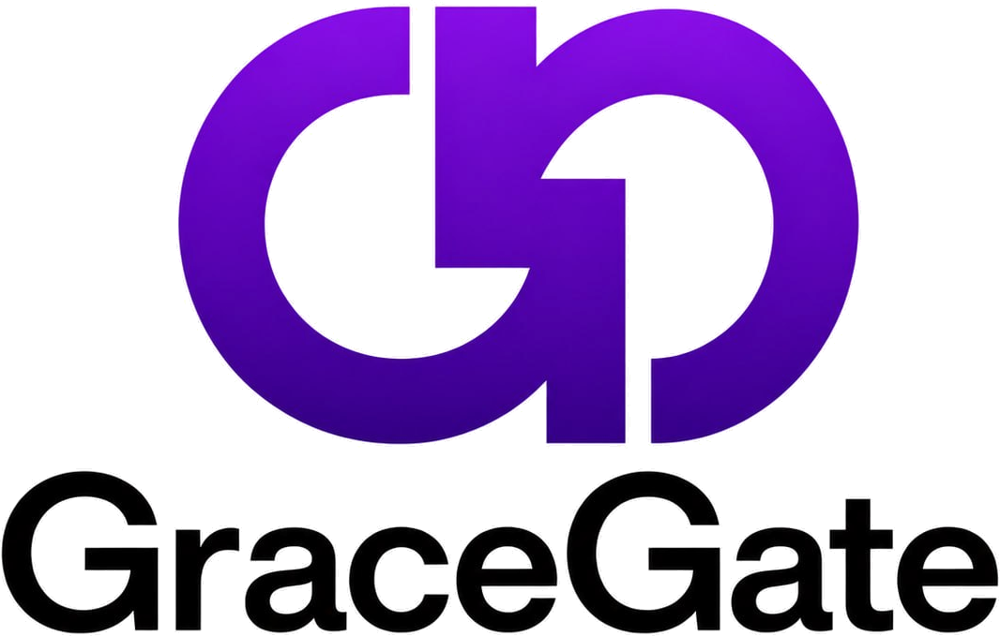

<div align="center">
  

  <p><strong>Cybersecurity analyst &amp; digital product builder</strong><br/>
  Powered by GraceGate Technologies</p>
</div>

## Overview

The GraceGate portfolio site, built with **Next.js (App Router)**, **React 19**, **Tailwind CSS v4** and **Motion** for animation.

Highlights:

- Animated preloader, scroll progress bar and cursor-following glow
- Hero with staggered headline reveal, parallax, orbiting logo mark and a live "terminal"
- Spotlight + tilt cards, magnetic buttons, animated counters and an infinite tool marquee
- Filterable project grid with shared-layout transitions
- Scroll-linked process timeline and an auto-playing, swipeable testimonial carousel
- Project request modal that saves to Supabase (falls back to `localStorage` when not configured)
- Respects `prefers-reduced-motion`

## Getting started

**Prerequisites:** Node.js 20+

```bash
npm install
npm run dev
```

Open http://localhost:3000.

### Environment

Copy `.env.example` to `.env.local` and fill in your Supabase project to store service requests:

```
NEXT_PUBLIC_SUPABASE_URL=...
NEXT_PUBLIC_SUPABASE_ANON_KEY=...
```

Optionally set `NEXT_PUBLIC_SITE_URL` to your production URL for correct social preview links.

## Scripts

| Command         | Description              |
| --------------- | ------------------------ |
| `npm run dev`   | Start the dev server     |
| `npm run build` | Production build         |
| `npm start`     | Serve the production build |
| `npm run lint`  | Type-check the project   |

## Structure

```
app/            Layout, global styles, page and favicon
components/     Page sections and shared UI/motion primitives
lib/            Content (data.ts), types and Supabase client
public/brand/   GraceGate and GraceGate Technologies logos
public/projects Project imagery
```

Site content (services, projects, testimonials, contact details) lives in `lib/data.ts`.
